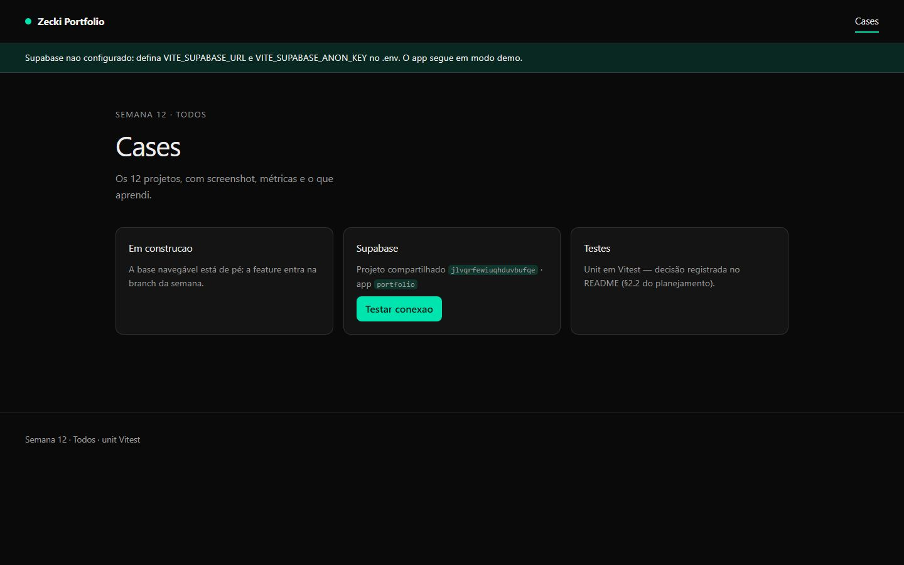
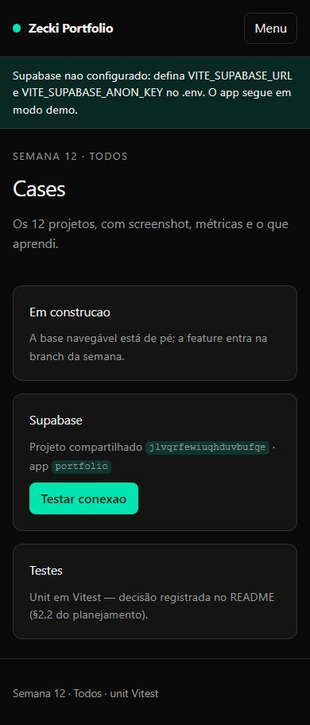

# Zecki Portfolio — Vitrine dos 12 cases


> Vitrine dos **12 cases** do roadmap, com métricas e "o que aprendi" de cada projeto.
> Pilar **Todos** · Semana 12 do roadmap · Milestone `m1-portfolio` · Demo pública no GitHub Pages.

---

## Screenshots do Produto

### Cases
| Desktop | Mobile |
|---------|--------|
|  |  |

> **Baselines:** 2 screenshots (1 tela × desktop/mobile) versionadas em `docs/screenshots/`, geradas
> por `e2e/screenshots.spec.ts` (Playwright). Regerar com `npm run e2e:screenshots`.

---

## Documentação

| Arquivo | Descrição |
|---------|-----------|
| [`docs/portfolio-case.md`](./docs/portfolio-case.md) | Case study: contexto, desafio, solução, métricas e "o que aprendi" |
| [`docs/a11y/relatorio-axe.json`](./docs/a11y/relatorio-axe.json) | Relatório de acessibilidade (axe) das rotas públicas |
| [`docs/clarity-integracao.md`](./docs/clarity-integracao.md) | Runbook de integração do Microsoft Clarity (mapa de calor) |
| [`docs/manter-online.md`](./docs/manter-online.md) | Estratégia zero-standby (custo zero) |

---

## Setup Rápido

```bash
npm install          # o postinstall roda `npm run env` e gera o ambiente
npm start            # ng serve → http://localhost:4200
```

O app funciona **sem backend**: sem `VITE_SUPABASE_URL`/`VITE_SUPABASE_ANON_KEY` ele sobe em
**modo demo** (mostra o aviso e o health-check retorna "sem resposta"). Para conectar o Supabase,
copie `.env.example` para `.env` e preencha a *anon key*.

---

## Comandos Principais

| Comando | Descrição |
|---------|-----------|
| `npm start` | Servidor de desenvolvimento (`ng serve`) |
| `npm run build` | Build de produção (`ng build`) |
| `npm run lint` | ESLint + angular-eslint |
| `npm test` | Testes unitários (Vitest, watch) |
| `npm run test:ci` | Testes unitários + cobertura (CI) |
| `npm run e2e` | Playwright (smoke + axe + screenshots) |
| `npm run e2e:smoke` | Somente o smoke E2E (navegação + menu) |
| `npm run e2e:a11y` | Varredura de acessibilidade (gera relatório axe) |
| `npm run e2e:screenshots` | Regenera os prints do README |
| `npm run analyze` | Análise de bundle (`ng build --stats-json`) |

> O Playwright aceita `E2E_BASE_URL` para rodar contra uma porta dedicada:
> `E2E_BASE_URL=http://localhost:4340 npm run e2e`.

---

## Telas Implementadas

| Tela | Rota | Conteúdo |
|------|------|----------|
| Raiz | `/` | Redireciona para `/cases` (home do portfólio) |
| Cases | `/cases` | Vitrine dos 12 cases + cartões explicativos + health-check do Supabase |
| Fallback | `**` | Redireciona para `/cases` (deep links de cases caem na vitrine) |

Não há tela de login nem área autenticada.

---

## Qualidade & Performance

| Métrica | Resultado |
|---------|-----------|
| **Unit tests (Vitest)** | 3/3 passando (2 arquivos) |
| **Cobertura** | 73,5% statements · 73,3% branches · 33,3% functions · 74,4% lines |
| **E2E (Playwright)** | 6/6 passando (smoke, axe, screenshots) |
| **Acessibilidade (axe)** | 0 violações graves/críticas |
| **Lighthouse** | Performance **99** (98–100) · A11y **100** · Boas Práticas **100** · SEO **100** |
| **ESLint** | 0 erros · 0 warnings |
| **Bundle inicial** | 462,7 kB raw (≈114,8 kB transfer) |
| **Responsivo** | mobile (390) / desktop (1440) |

> O aviso `bundle initial exceeded maximum budget` (350 kB) é conhecido: o framework + Tailwind +
> Supabase somam ~463 kB. A meta de otimização (code splitting / lazy) está no roadmap de performance.

---

## Acessibilidade

Varredura automatizada com `@axe-core/playwright` (tags WCAG 2.0/2.1 A+AA) em `/` e `/cases` —
**zero violações** graves ou críticas.

- Skip-link "Pular para o conteúdo", foco visível (`:focus-visible`) e hierarquia de títulos correta.
- Avisos usam `role="status"`; o botão de menu expõe `aria-expanded`/`aria-controls`.
- `@media (prefers-reduced-motion: reduce)` zera animações e transições.
- Relatório versionado em [`docs/a11y/relatorio-axe.json`](./docs/a11y/relatorio-axe.json).
  Reproduzir: `npm run e2e:a11y`.

---

## Design — decisão e intenção

### Conceito

**Zecki Portfolio** é a peça de fechamento do roadmap: um catálogo sóbrio e escuro onde o conteúdo
(os cases, com métricas) é o protagonista. O visual não compete com os prints — ele enquadra.

### Identidade visual

| Token | Valor | Para quê |
|-------|-------|----------|
| `--fundo` `#0a0a0a` | tinta quase preta | Palco escuro, deixa as métricas e os acessos saltarem |
| `--superficie` `#141414` | grafite | Cartões — separa conteúdo do fundo sem bordar demais |
| `--texto` `#ededed` | branco suave | Texto principal com bom contraste, sem branco puro |
| `--tenue` `#9b9b9b` | cinza | Metadados e descrições — hierarquia sem gritar |
| `--acento` `#00e5b0` | verde-água | Ação: CTA, foco, pontos — **delata o que é interativo** |
| `--acento-contraste` `#04231d` | verde profundo | Texto sobre o acento (contraste garantido) |

- **Tipografia:** `Inter` (system-ui de fallback) — legibilidade em telas pequenas, sem custo de download.
- **Formas:** cantos arredondados (`0.75rem`) e bordas de 1px com `color-mix` para separar cartões.
- **Grid:** cartões `repeat(auto-fit, minmax(16rem, 1fr))` — reflui de 1 a 3 colunas sem media query extra.

---

## Estrutura do Projeto

```text
src/
├─ app/
│  ├─ core/                 # config de ambiente + SupabaseService (health-check, modo demo)
│  ├─ pages/cases/          # página de cases (rota /cases)
│  ├─ app.ts / app.html     # shell: header, menu mobile, main, footer
│  └─ app.routes.ts         # rotas públicas ('' → /cases, 'cases', '**')
├─ environments/            # ambiente.local.ts (gerado, gitignored)
└─ index.html
e2e/                        # Playwright: smoke, acessibilidade (axe), screenshots
docs/                       # case study, a11y, screenshots, runbooks
scripts/                    # gerar-ambiente.mjs (codegen de ambiente)
.github/workflows/          # CI (lint→build→unit→e2e→lighthouse) + Deploy (GitHub Pages)
```

---

## Stack

| Responsabilidade | Tecnologia |
|------------------|------------|
| Framework | Angular 22 (standalone, signals, zoneless) |
| Linguagem | TypeScript 6 |
| Estilização | Tailwind CSS 4 |
| Backend/Dados | Supabase (Postgres + Auth + RLS) — opcional, cai em modo demo |
| Testes | Vitest (unit) · Playwright + axe (E2E/a11y) |
| Qualidade | ESLint + angular-eslint · Lighthouse CI |
| Deploy | GitHub Pages (site estático) |

---

## Decisão de teste: Vitest

> Cada repo do roadmap alterna Karma/Vitest de propósito: agnóstico de ferramenta, escolha por contexto.

Neste repo o contexto é um app **standalone + zoneless** com lógica de estado em signals:

- **Nativo ESM + TypeScript:** o Vitest transforma os specs no mesmo pipeline do `ng build`.
- **CI sem browser:** roda em Node puro — mais rápido e estável que o Karma.
- **Karma em fim de vida:** o Angular já o marca como deprecated.
- **Cobertura V8 embutida:** cobertura nativa, sem plugin extra.
- **API familiar:** `describe/it/expect` no mesmo formato do Karma/Jasmine.

---

## Branches & Workflow Git

```text
main      → produção (build estático; push dispara deploy no GitHub Pages)
homolog   → validação/release de PRs (staging)
develop   → integração diária (merges das feat/*)
feature   → feat/<assunto> + PR para develop
```

- **Commits:** `feat:`, `fix:`, `test:`, `docs:`, `design:`, `ops:`, `backend:` (Conventional Commits)
- **PRs:** via pull request template; revisados e mergeados por milestone
- **main:** protegida — merge somente via PR de `homolog`
- Rastreabilidade com issues, labels (`feat/test/design/ops/backend`) e milestones

---

## Bots (estação local + CI)

Os bots vivem em `bots/` e rodam localmente e no GitHub Actions.

| Bot | O que faz | Como roda localmente |
|-----|-----------|----------------------|
| **Humano** (`bots/humano/navegacao-humana.mjs`) | Navega com comportamento de pessoa real (cliques com atraso, scroll gradual, hesitação). Detecta travamento e navegação quebrada. | `BOT_URL=http://localhost:4200 node bots/humano/navegacao-humana.mjs` |
| **Analisador de erros** (`bots/analise-erros/analisador.mjs`) | Lê logs de build/e2e/CI, classifica por severidade e aponta padrões repetidos. | `node bots/analise-erros/analisador.mjs` |
| **CI + Lighthouse** | `npm ci` → lint → build → Vitest (coverage) → Playwright + axe → Lighthouse. | `npm run build` + `npx lhci autorun` |

---

## Microsoft Clarity (mapa de calor)

Integração **planejada e documentada** em [`docs/clarity-integracao.md`](./docs/clarity-integracao.md):
o snippet só deve ser injetado quando `CLARITY_PROJECT_ID` estiver definida (evita load inválido).

---

## Deploy

- **GitHub Pages** (projeto público): `https://zecki1.github.io/angular-portfolio/`
  Workflow [`.github/workflows/deploy-pages.yaml`](./.github/workflows/deploy-pages.yaml) — build com
  `--base-href=/angular-portfolio/` + fallback SPA (`index.html` → `404.html`).
- **Política do workspace:** projetos públicos → GitHub Pages; projetos privados → Vercel (config em `vercel.json`).
- Estratégia zero-standby documentada em [`docs/manter-online.md`](./docs/manter-online.md).

---

## Links Úteis

- **Produção (GitHub Pages):** https://zecki1.github.io/angular-portfolio/
- **Repositório:** https://github.com/zecki1/angular-portfolio
- **Roadmap do portfólio:** `planejamento-projetos.md` (Semana 12 — Zecki Portfolio)

---

## Licença

MIT — ver [`LICENSE`](./LICENSE).
